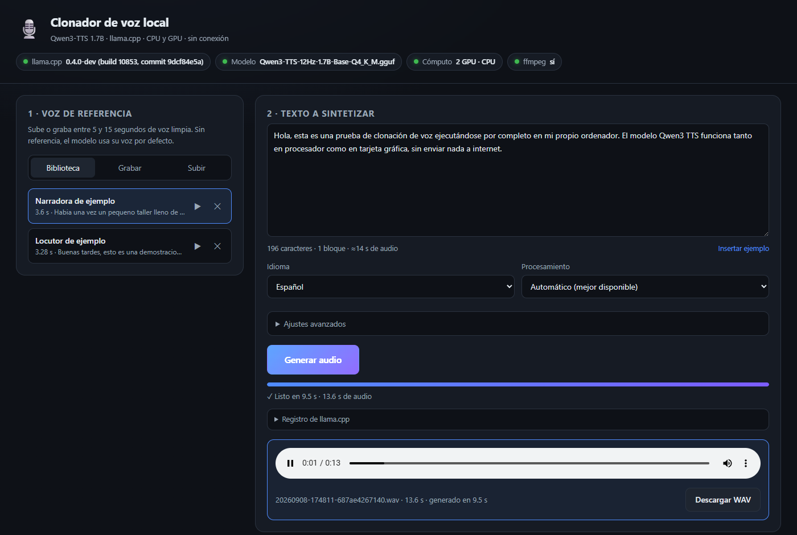

<h1 align="center">Sintetizador de audio/video</h1>

<p align="center">
  Clonación de voz y texto a voz <b>100 % local</b>, con interfaz web.<br>
  Todo corre en Docker con GPU NVIDIA. Nada sale de tu ordenador.
</p>

<p align="center">
  
</p>

---

Graba o sube **10-15 segundos** de una voz, escribe un texto y obtén ese texto
hablado con esa misma voz. Por debajo usa
[**Qwen3-TTS-12Hz-1.7B**](https://huggingface.co/ggml-org/Qwen3-TTS-12Hz-1.7B-Base-GGUF)
en formato GGUF, ejecutado con `llama-tts` de
[**llama.cpp**](https://github.com/ggml-org/llama.cpp).

## Estado actual

| Pieza | Estado |
|---|---|
| **Backend** (`backend/`) | FastAPI 2.4 por capas (rutas · servicios · repositorios), Swagger en `/api/docs`, 67 tests en verde |
| **Proyectos** | Cada generación es un proyecto en **MongoDB** con la configuración de cada segmento: se reabre, se edita y se regenera un segmento suelto |
| **Voz emocional** | LLM local (Qwen3.5 2B en CPU) que segmenta el texto por emociones; cada segmento con su perfil |
| **Meet-Video** | Avatares con fondos día/noche/lluvia (editables y descargables en ZIP); MP4 del mensaje con el avatar y la voz de cada segmento, fijo o **animado** |
| **Avatar animado** | SadTalker local en su propio contenedor: labios, parpadeo y expresión; ~18× la duración del audio en la GTX 1650, pico de 3,1 GB de VRAM |
| **Memoria** | Cada etapa carga su modelo y lo libera al terminar: LLM → TTS → animación, nunca dos a la vez |
| **Front** (`front/`) | React 18 + Vite. Pantalla completa con la cabecera fija y cada bloque con su scroll. Diálogos con SweetAlert2 y pistas al pasar el ratón con Tippy.js |
| **Despliegue** | `docker-compose.yml`: backend con CUDA + nginx sirviendo el front compilado |
| **Compatibilidad** | La API responde exactamente igual que la versión original (rutas, JSON y mensajes) |
| **Validado** | Tests automáticos, comparación de respuestas con la versión anterior y pruebas de extremo a extremo en Chrome (subir voz, generar, cancelar, guardar ajustes, historial, analizar y editar emociones, generar en modo emocional) |
| **Equipo de referencia** | GTX 1650 (4 GB): ~4,5 s por frase corta con la GPU |

---

## 🚀 Puesta en marcha

Requisitos en el host: Docker con Compose, driver NVIDIA y
`nvidia-container-toolkit`. No hace falta Python ni Node en el host.

```bash
docker compose up -d --build
```

| Qué | URL |
|---|---|
| Aplicación web | <http://localhost:8094> |
| Swagger (documentación interactiva de la API) | <http://localhost:8094/api/docs> |
| ReDoc | <http://localhost:8094/api/redoc> |
| Backend directo (sin nginx) | <http://localhost:8093> |

Si en `modelo/` no están los `.gguf`, la web muestra un panel para descargarlos
(~1,5 GB, reanudable y con verificación SHA-256). Ver [`modelo/LEEME.md`](modelo/LEEME.md).

### Servicios

Red dedicada `clonar-voz-net` (`192.168.93.0/24`):

| Servicio | Imagen | IP | Puerto host | Función |
|---|---|---|---|---|
| `clonar-voz-backend` | `clonar-voz-backend:cuda` (de `backend/Dockerfile`) | .10 | 8093 → 8080 | API + `llama-tts` en la GPU |
| `clonar-voz-front` | `nginx:1.27-alpine` | .11 | 8094 → 80 | Sirve `./html` y reenvía `/api` al backend |
| `clonar-voz-front-build` | `node:22-alpine` | .12 | — | Compila `front/` en `./html` y termina |
| `clonar-voz-mongo` | `mongo:8.2` | .15 | 127.0.0.1:27018 → 27017 | Proyectos y configuración de sus segmentos |
| `clonar-voz-animador` | `clonar-voz-animador:sadtalker` (de `animador/Dockerfile`) | .14 | — (solo red interna) | SadTalker en la GPU; en reposo no tiene ningún modelo cargado |

nginx espera a que el backend esté *healthy* (healthcheck sobre `/api/salud`) y
a que la compilación del front termine bien.

### Volúmenes

| Carpeta del host | En el contenedor | Contenido |
|---|---|---|
| `./modelo` | `/app/modelo` | Pesos `.gguf` del modelo y del vocoder |
| `./audios/referencias` | `/app/audios/referencias` | Voces a clonar: `<id>/referencia.wav` + `voz.json` |
| `./audios/generados` | `/app/audios/generados` | WAVs sintetizados (el historial) |
| `./config` | `/app/config` | `config.json` con los ajustes guardados desde la web |
| `./cache/cuda` | `/app/cache/cuda` | Kernels CUDA compilados (ver más abajo) |
| `./html` | `/usr/share/nginx/html` | Front compilado (lo genera `clonar-voz-front-build`) |
| `./modelos-llm` | `/app/modelos-llm` | `Qwen3.5-2B-Q4_K_M.gguf` (1,3 GB); el backend lo carga solo mientras analiza |
| `./modelos-animacion` | `/modelos` (en el animador) | Pesos de SadTalker (~1,3 GB) y `SHA256SUMS` |
| `./datos/mongo` | `/data/db` (en Mongo) | Base de datos de proyectos |
| `./cache/animacion` | `/app/animacion` · `/trabajo` | Área de trabajo compartida backend ↔ animador (se vacía sola) |
| `./avatares` | `/app/avatares` | Una carpeta por avatar: `avatares/Luis/` con `avatar.png`, `dia.png`, `noche.png`, `lluvia.png`, `avatar.json` y `compuestas/` (caché) |
| `./videos` | `/app/videos` | Meet-Videos (MP4), con el mismo nombre que su WAV |

El backend corre como el usuario `1000:1000`, así que todo lo que escribe en
estas carpetas pertenece a tu usuario, no a root.

### Operaciones habituales

```bash
# Recompilar el front tras cambiarlo (nginx lo sirve al recargar, sin reiniciar)
docker compose run --rm clonar-voz-front-build

# Reconstruir y reiniciar el backend tras cambiarlo
docker compose up -d --build clonar-voz-backend

# Tests del backend (en un contenedor aparte, sin GPU ni datos reales)
docker build --target pruebas -t clonar-voz-backend:pruebas backend && \
  docker run --rm clonar-voz-backend:pruebas

# Registro del backend (tareas, voces, descargas)
docker logs -f clonar-voz-backend

# Descargar el modelo desde la terminal
docker compose exec clonar-voz-backend python -m app.servicios.huggingface --dir /app/modelo
```

---

## ▶ Flujo de trabajo

1. **Texto.** En la barra junto al título se elige cómo escribir:
   - **📝 Un solo texto**, con la casilla **☐ Segmentación por IA** sobre el
     cuadro. Sin ella, todo es un único segmento. Con ella, al dejar de escribir,
     la IA lo divide por emociones y sugiere la configuración de cada parte.
   - **✍ Manual**: tú creas cada segmento con **➕ Añadir segmento**.
2. **🎬 Meet-Video**, en una sola línea justo debajo del texto: el interruptor y el
   fondo por defecto (☀️ 🌙 🌧️).
   - Con él activo el avatar **siempre se anima**.
   - No hay avatar por defecto: siempre hay que elegirlo.
   - **Un solo texto sin segmentación por IA**: no hay tarjeta de segmento. Se usan
     dos bloques:
     - **«Ajustes generales del audio»**: temperatura, top-p, etc.
     - **«Ajustes generales del video»**: avatar (con su fotograma), voz, emoción
       e intensidad del texto completo, expresión y estilo de cabeza.
   - **Manual o segmentación por IA**: todo se configura en cada segmento, y el
     bloque de ajustes generales del audio no aparece.
3. **Cada segmento es una tarjeta**; al hacer clic se configura:
   - texto (en manual), emoción, intensidad y voz;
   - avatar y fondo (☀️ día, 🌙 noche o 🌧️ lluvia);
   - ajustes de audio (temperatura, top-p, top-k, ritmo, tono, volumen, pausa);
   - animación (expresión, estilo de cabeza).

   Los valores vienen sugeridos por la emoción y los que cambias quedan marcados con ✎.
4. **▶ Comenzar**, un único botón. Genera el audio de cada segmento, luego el video
   de cada segmento y al final lo une todo. Cada tarjeta muestra su estado
   (🎙 ✓ · 🎬 ⏳).
5. **Resultado**: vista previa arriba, el resultado completo y la lista de partes
   (🎬 video + audio o 🎙 solo audio). Cada parte y el total se descargan en MP4 y WAV.

**3 · Historial.** Cada proyecto aparece con su nombre. Al hacer clic se abre un
modal con:
- título;
- vista previa;
- resultado completo;
- partes, con **▶ reproducir**, **✎ Editar** y descargas;
- un pie con Eliminar y Cancelar.

El modal solo se cierra con ✕ o Cancelar.

**✎ Editar** abre un segundo modal con la configuración guardada de esa parte. Al
pulsar **↻ Regenerar segmento**:
- se rehace solo esa parte;
- las demás se conservan byte a byte;
- el audio y el video completos se vuelven a unir, reemplazando la versión anterior.

**Base de datos (MongoDB).** La colección `clonar_voz.proyectos` guarda un documento
por proyecto:
- título y texto;
- ajustes generales;
- por segmento: configuración (ids de voz y avatar, fondo, ajustes) y archivos.

Los audios y videos siguen en disco. Al arrancar, los audios anteriores a la base
de datos se migran solos. Esos proyectos se pueden ver, pero no regenerar, porque
no guardaron su configuración.

> MongoDB está fijado a `mongo:8.2`: las versiones `8` y `latest` que hay en este
> equipo no arrancan en kernels Linux ≥ 6.19 (SERVER-121912), y el host usa el 7.0.

---

## 🎭 Voz emocional

Qwen3-TTS Base solo clona: no acepta instrucciones de estilo. La emoción se
construye por segmentos:

1. **Segmentación.** El backend parte el texto en frases y un LLM local
   (Qwen3.5 2B) **solo etiqueta** cada una con `emocion:intensidad`. La salida
   está forzada por un esquema JSON, así que el LLM nunca reescribe ni pierde
   texto. Las frases seguidas con la misma etiqueta se agrupan.
2. **Síntesis por segmento.** Cada segmento usa su propia temperatura, top-p y
   top-k. Son desplazamientos sobre tus ajustes avanzados, escalados por la
   intensidad: baja 40 %, media 70 %, alta 100 %.
3. **Prosodia con ffmpeg.** `rubberband` cambia ritmo y tono sin efecto
   «ardilla»; además se ajusta el volumen y la pausa tras cada segmento.
4. **Unión con ffmpeg** (`concat` + `alimiter`) en el entregable final.

| Emoción | Temp | Ritmo | Tono | Volumen | Pausa |
|---|---|---|---|---|---|
| 😐 neutro | = | ×1 | 0 | 0 dB | 250 ms |
| 😊 alegría | +0,15 | ×1,07 | +1,2 st | +1,5 dB | 200 ms |
| 🤩 entusiasmo | +0,25 | ×1,12 | +1,8 st | +2,5 dB | 180 ms |
| 😮 sorpresa | +0,20 | ×1,04 | +2,0 st | +1,5 dB | 300 ms |
| 😢 tristeza | −0,20 | ×0,88 | −1,5 st | −2,5 dB | 500 ms |
| 😠 enojo | +0,15 | ×1,06 | −0,5 st | +3,0 dB | 250 ms |
| 😨 miedo | +0,10 | ×1,10 | +0,8 st | −1,5 dB | 300 ms |
| 😌 calma | −0,25 | ×0,93 | −0,5 st | −1,0 dB | 400 ms |

Valores a intensidad alta. Los perfiles están en `backend/app/servicios/emociones.py`.

**En la web:** activa «🎭 Voz emocional», pulsa «Analizar emociones», revisa o
cambia la emoción de cada segmento y genera. Sin analizar antes, el análisis se
hace solo al generar.

**Marcas manuales** (no necesitan el LLM):
`[neutro] Estamos aquí presentando este escenario. [entusiasmo:alta] ¡Qué emoción, cuánta alegría! [tristeza] Pero esto no lo esperábamos.`

**Si el LLM no responde,** la síntesis no falla: sale entera en tono neutro y se
avisa en el registro.

Rendimiento medido en este equipo:
- Análisis: 1–3 s para 3–8 frases (~25 tok/s en CPU, 0,7 GB de RAM).
- Síntesis emocional de 3 segmentos: ~15 s en total.

Medición objetiva sobre la misma frase:

| Emoción | Tono mediano | Volumen medio |
|---|---|---|
| neutro | 132 Hz | −20,0 dB |
| alegría alta | 155 Hz | −18,0 dB |
| tristeza alta | 124 Hz | −23,2 dB |
| enojo alto | 136 Hz | −17,2 dB |

**Bajo demanda.** El LLM no es un servicio aparte: el backend arranca `llama-server`
solo durante el análisis (≈1,5 s de carga) y lo apaga al terminar. Medido: 0
procesos antes, análisis en 4,4 s, 0 procesos después.

**Por qué Qwen3.5 2B y en CPU.** El TTS ocupa ~2,8 GB de los 4 GB de la GPU en
pico, así que el LLM va en CPU para no competir con él. Frente a Qwen3.5 4B, el
2B fue el doble de rápido (25 frente a 12 tok/s) y acertó más etiquetas en las
pruebas de español: el 4B tomó una decepción y una queja por «sorpresa».

---

## 🎬 Meet-Video

Convierte el mensaje en un video tipo videollamada. Por ahora la imagen es fija,
sin movimiento.

**Avatares** (tarjeta «🎬 Meet-Video · Avatares» → Nuevo). Cada uno necesita:
- la imagen de la persona, mejor un PNG con fondo transparente;
- **los tres fondos obligatorios**: día, noche y lluvia.

Opcionalmente se le asocia una voz, con la que habla por defecto. Se guarda en
`avatares/<Nombre>/`; si el nombre se repite, la carpeta pasa a `Luis-2`, `Luis-3`…

**Composición** (1280×720, 25 fps, H.264 + AAC):
- el fondo de la escena a pantalla completa;
- el avatar **siempre alineado abajo** y con el **alto proporcional**, sin deformarse;
- su **ancho** y su **separación respecto a la izquierda** los define cada avatar;
- una etiqueta con el nombre abajo a la izquierda, como en Meet.

Por defecto el avatar ocupa el 65 % del ancho y va a un 25 % del borde izquierdo.

**Posicionar el avatar.** Al crear el avatar (**➕ Nuevo avatar**) o al editarlo
(**✎**) se abre un modal con un lienzo 16:9 que reproduce exactamente la
composición de ffmpeg:
- se arrastra para moverlo en horizontal;
- el tirador del borde derecho cambia el ancho;
- también hay deslizadores, «Centrar» y «Restablecer»;
- se previsualiza sobre los tres fondos.

Nunca sube ni baja ni se sale del fotograma. Al guardar, los fotogramas en caché
se rehacen solos.

**Generar.** Activa «🎬 Meet-Video» y elige:
- el fondo para todo el mensaje (☀️ Día · 🌙 Noche · 🌧️ Lluvia);
- el avatar general.

Con la voz emocional activa, cada segmento puede llevar su propia **voz** y su
propio **avatar**. El video cambia de avatar justo cuando empieza su audio.

Qué voz suena en cada segmento, de mayor a menor prioridad:
1. la voz elegida en el segmento;
2. la voz del avatar del segmento;
3. la voz elegida en la biblioteca;
4. la voz del avatar general.

**Resultado.** El reproductor muestra el video y permite descargar el MP4 y el
WAV. En el historial, 🎬 abre el video. Al borrar un audio se borra también su
video.

Medido en este equipo: un mensaje de 3 segmentos (13 s de video) tarda unos 15 s,
análisis emocional incluido.

---

## 🎭 Avatar animado (SadTalker)

Convierte una foto en un video que narra un audio. Está disponible de dos formas:
- la tarjeta **«🎭 Avatar animado (IA)»**: foto + audio → MP4;
- la casilla **«🎭 Avatar animado»** del Meet-Video, que anima cada tramo del mensaje.

**Qué hace SadTalker de forma nativa**
- sincronía labial;
- parpadeo automático;
- pose de cabeza, con 46 estilos o casi fija;
- una escala global de expresión.

**Qué no controla por separado:** la mirada y la frecuencia de parpadeo. La
interfaz solo ofrece las opciones que el motor declara en
`GET /api/animaciones/motores`.

**Transparencia.** SadTalker devuelve MP4 sin alfa. Para el Meet-Video:
1. se anima la imagen completa con la cabeza casi fija (`--preprocess full --still`);
2. se reaplica la máscara alfa del PNG original;
3. el resultado se coloca sobre el fondo, igual que la imagen fija: abajo, 65 %
   del ancho y a un 25 % del borde izquierdo.

**Arquitectura**
- **Interfaz común.** `ServicioAnimacion` habla con los motores a través de
  `ProveedorAnimacion`, que define `disponible()`, `capacidades()`, `validar()` y
  `animar()`. `ProveedorSadTalker` es la primera implementación. Para añadir
  LivePortrait, MuseTalk o EchoMimic basta con otra clase y registrarla en
  `servicios/__init__.py`.
- **Contenedor propio.** SadTalker exige Python 3.8 + torch 1.12.1/CUDA 11.3 y
  corre aislado. Un servidor HTTP mínimo, solo con la biblioteca estándar, lanza
  `inference.py` como un **proceso por animación**, así que la VRAM se libera al
  terminar.
- **Trabajos.** Reutilizan el sistema de tareas del backend:
  - estados `pendiente → procesando → completado | fallido | cancelado`;
  - progreso real en fotogramas, tal como lo informa el motor;
  - cancelación que mata el proceso;
  - el cerrojo de la GPU es compartido con el TTS, así que nunca coinciden en la GPU.
- **Errores.** Un CUDA out of memory se detecta y se informa con la sugerencia
  de reintentar en CPU.

**Medido en la GTX 1650**

| Prueba | Tiempo | VRAM pico |
|---|---|---|
| CLI, 3,3 s de audio | 59 s (10 s de carga, 37 s de render, 7 s de integración) | 3,05 GB |
| Tarjeta, 3,3 s, fondo de noche | 62 s | ≈3,1 GB |
| Meet-Video animado, 7,2 s | 132 s (LLM + TTS + animación) | 3,6 GB en total |
| Cancelar a mitad | inmediato | vuelve a 0,7 GB (escritorio) |

**Instalación de los pesos.** Se descargan de las releases oficiales de GitHub y
se guardan fuera del repo, en `./modelos-animacion`:

```bash
B=https://github.com/OpenTalker/SadTalker/releases/download/v0.0.2-rc
F=https://github.com/xinntao/facexlib/releases/download/v0.1.0
mkdir -p modelos-animacion/checkpoints modelos-animacion/gfpgan/weights
curl -L -o modelos-animacion/checkpoints/mapping_00109-model.pth.tar      $B/mapping_00109-model.pth.tar
curl -L -o modelos-animacion/checkpoints/mapping_00229-model.pth.tar      $B/mapping_00229-model.pth.tar
curl -L -o modelos-animacion/checkpoints/SadTalker_V0.0.2_256.safetensors $B/SadTalker_V0.0.2_256.safetensors
curl -L -o modelos-animacion/gfpgan/weights/alignment_WFLW_4HG.pth        $F/alignment_WFLW_4HG.pth
curl -L -o modelos-animacion/gfpgan/weights/detection_Resnet50_Final.pth  $F/detection_Resnet50_Final.pth
cd modelos-animacion && sha256sum -c SHA256SUMS
```

No se usan el modelo de 512 px ni el realce GFPGAN, porque no caben en 4 GB.

**Licencias**
- SadTalker: Apache 2.0, salvo componentes de terceros listados en su LICENSE.
- facexlib: MIT.
- El código está fijado al commit `cd4c046` (el repositorio no cambia desde 2023).

**Notas de compatibilidad**
- `lmdb` está fijado a 1.4.1, que trae wheel para 3.8; la última versión solo
  publica el código fuente y no compila sin herramientas.
- `gradio` se omite porque no se usa.

---

## 🖥️ Distribución de la pantalla

- **Cabecera** de alto fijo (72 px).
- **El resto** de la pantalla lo calcula React y se recalcula al redimensionar:
  - **Columna izquierda**: Voz de referencia 25 %, Meet-Video · Avatares 25 %,
    Historial 50 %, cada uno con su scroll. En el historial, un proyecto debajo
    de otro.
  - **A la derecha**, el proyecto («1 · Texto a sintetizar») ocupa el 100 % del
    alto, con su scroll.
- En pantallas estrechas (≤ 950 px) todo se apila y la página se desplaza.

Las explicaciones de cada control son **pistas (Tippy.js)** que aparecen al
instante al pasar el ratón. Avisos y confirmaciones van con **SweetAlert2**, con el
tema de la app.

---

## 🧱 Arquitectura

```
navegador ──► nginx :8094 ──┬── /        → ./html (React compilado)
                            └── /api/*   → clonar-voz-backend :8080
                                              │
                                              ├─ hilo de síntesis ─► llama-tts (CUDA) por bloque
                                              │       └─ cola de eventos ─► SSE /api/tarea/{id}/eventos
                                              └─ ffmpeg (normaliza las referencias)
```

Recorrido de una síntesis: `POST /api/generar` valida, trocea el texto por frases
y devuelve un id al momento → un hilo lanza `llama-tts` por cada bloque y publica
`bloque`/`log`/`fin` en una cola → el navegador lo recibe en vivo por SSE → los
trozos se unen en `audios/generados/<fecha>-<id>.wav`.

### Backend (`backend/`)

Python 3.12 + FastAPI, organizado por capas. Las rutas no contienen lógica; los
servicios no saben nada de HTTP.

```
backend/
├── Dockerfile               etapas: base → pruebas (pytest) → servicio (por defecto)
├── requirements.txt         fastapi, uvicorn, python-multipart
├── requirements-dev.txt     + pytest, httpx
├── app/
│   ├── main.py              crear_app(): FastAPI, Swagger, ciclo de vida, routers
│   ├── __main__.py          `python -m app` para arrancar sin Docker
│   ├── nucleo/              ── transversal
│   │   ├── ajustes.py       rutas (configurables por entorno) y constantes
│   │   ├── configuracion.py config.json: defectos, validación de tipos, escritura atómica
│   │   └── errores.py       errores de dominio → {"detail": "..."} con su código HTTP
│   ├── esquemas/            ── contratos Pydantic (lo que documenta Swagger)
│   │   ├── sistema.py       Estado, Configuracion, límites de cada ajuste
│   │   ├── audio.py         Voz, PeticionGenerar, TareaCreada, Salida
│   │   └── modelo.py        Catalogo, PeticionDescarga, ProgresoDescarga
│   ├── repositorios/        ── persistencia
│   │   └── proyectos.py     RepositorioProyectos: MongoDB o memoria (misma interfaz)
│   ├── servicios/           ── lógica de negocio
│   │   ├── __init__.py      crear_servicios(): monta el grafo de dependencias
│   │   ├── entorno.py       detecta llama-tts, .gguf, GPUs (prioriza la dedicada) y ffmpeg
│   │   ├── audio.py         ffmpeg: referencias, prosodia por pieza, concatenación
│   │   ├── texto.py         troceado por frases
│   │   ├── voces.py         biblioteca de referencias (subida por trozos con límite de 60 MB)
│   │   ├── salidas.py       historial de audios generados
│   │   ├── sintesis.py      piezas → llama-tts, tareas en hilos, cancelación, poda
│   │   ├── generacion.py    caso de uso «generar» (simple / emocional) y «analizar»
│   │   ├── emociones.py     perfiles, marcas [emocion:intensidad], filtros de prosodia
│   │   ├── analisis.py      segmentación: frases + etiquetas del LLM con esquema JSON
│   │   ├── llm.py           cliente de llama-server (API OpenAI)
│   │   ├── avatares.py      galería de avatares: subida, validación, fotogramas en caché
│   │   ├── video.py         composición del fotograma, tramos animados (máscara alfa) y MP4
│   │   ├── animacion.py     ProveedorAnimacion · ProveedorSadTalker · ServicioAnimacion
│   │   ├── descarga.py      descarga del modelo en segundo plano
│   │   └── huggingface.py   descarga reanudable + SHA-256 (también CLI)
│   └── api/                 ── capa HTTP
│       ├── dependencias.py  inyección de los servicios en las rutas
│       ├── sse.py           utilidades Server-Sent Events
│       └── rutas/           sistema · modelo · voces · generacion · emociones · avatares · animaciones · proyectos · salidas
└── tests/                   servicios (troceado, audio, config, comando) y contrato de la API
```

Variables de entorno del backend:

| Variable | Por defecto | Uso |
|---|---|---|
| `CLONAR_DIR_MODELO` | `<base>/modelo` | Carpeta de los `.gguf` |
| `CLONAR_DIR_VOCES` | `<base>/voces` | Referencias (en Docker: `/app/audios/referencias`) |
| `CLONAR_DIR_SALIDAS` | `<base>/salidas` | Generados (en Docker: `/app/audios/generados`) |
| `CLONAR_DIR_TMP` | `<base>/.tmp` | Trozos intermedios (en Docker: `/tmp/clonar-voz`) |
| `CLONAR_CONFIG` | `<base>/config.json` | Archivo de ajustes |
| `CLONAR_DIR_AVATARES` | `<base>/avatares` | Avatares (en Docker: `/app/avatares`) |
| `CLONAR_DIR_VIDEOS` | `<base>/videos` | Meet-Videos (en Docker: `/app/videos`) |
| `CLONAR_MONGO_URL` | — | MongoDB de proyectos (en Docker: `mongodb://clonar-voz-mongo:27017`); vacío = en memoria |
| `CLONAR_LLM_MODELO` | — | `.gguf` del LLM, cargado bajo demanda (en Docker: `/app/modelos-llm/Qwen3.5-2B-Q4_K_M.gguf`) |
| `CLONAR_LLM_HILOS` | `6` | Hilos de CPU del LLM |
| `CLONAR_LLM_URL` | — | Alternativa: un llama-server externo siempre encendido |
| `CLONAR_ANIMADOR_URL` | — | Servidor de animación (en Docker: `http://clonar-voz-animador:8080`) |
| `CLONAR_DIR_ANIMACION` | `<base>/animacion` | Área compartida con el animador |
| `CLONAR_ANIMADOR_TIMEOUT` | `3600` | Segundos máximos por animación |
| `CLONAR_LLM_TIMEOUT` | `120` | Segundos máximos por petición al LLM |
| `CLONAR_LOG` | `INFO` | Nivel del registro |
| `CUDA_CACHE_PATH` | — | Caché de kernels CUDA (en Docker: `/app/cache/cuda`) |

Robustez:
- Una sola síntesis a la vez (las demás esperan turno) para no agotar la VRAM.
- Al apagar se matan los `llama-tts` en curso; al arrancar se limpian trozos huérfanos.
- Las rutas con ids o nombres de archivo no pueden salir de su carpeta (`../`).
- Validación de cada ajuste con límites, y errores 422 legibles en `detail`.
- `config.json` corrupto o con valores raros → se usan los valores por defecto.
- Los trozos temporales se borran también si la síntesis falla o se cancela.
- La subida de voces y ffmpeg corren fuera del bucle de eventos, así que el progreso en vivo de otra síntesis no se congela.

### Front (`front/`)

React 18 + Vite 5, JavaScript sin dependencias extra. Reutiliza la hoja de
estilos original (`src/estilos.css`).

```
front/src/
├── main.jsx                 arranque
├── App.jsx                  estado compartido: sistema, voces, voz elegida, historial
├── util.js                  api(), postJson(), formato de tamaños y tiempos
├── avisos.js                avisar / confirmar / avisoBreve con SweetAlert2
├── constantes.js            escenas (día, noche, lluvia)
└── componentes/
    ├── Cabecera.jsx         pastillas de estado (llama.cpp, modelo, cómputo, ffmpeg)
    ├── Aviso.jsx            problemas de instalación
    ├── PanelModelo.jsx      descarga del modelo (solo si falta)
    ├── PanelVoces.jsx       pestañas Biblioteca / Grabar / Subir
    ├── Grabadora.jsx        micrófono con vúmetro (MediaRecorder + Web Audio)
    ├── SubirVoz.jsx         archivo con arrastrar y soltar
    ├── PanelTexto.jsx       texto, voz emocional, ajustes, generación con SSE, resultado
    ├── Segmentos.jsx        tarjetas de segmento: texto, emoción, voz, avatar, fondo, ajustes
    ├── DetalleGeneracion.jsx vista previa + resultado + partes (y el modal)
    ├── EditarSegmento.jsx   modal para editar y regenerar una parte de un proyecto
    ├── Avatares.jsx         galería de avatares; alta y edición en modal (imágenes, nombre, posición), ZIP
    ├── PosicionAvatar.jsx   lienzo para colocar el avatar sobre el fondo (ancho y separación)
    ├── Pista.jsx            pistas al pasar el ratón (Tippy.js, sin retardo)
    ├── AnimarAvatar.jsx     foto + audio → video animado (estado, progreso, resultado)
    └── Historial.jsx        audios generados
```

Para desarrollar con recarga en caliente sin instalar Node:

```bash
docker run --rm -it -u 1000:1000 -v "$PWD/front:/front" -w /front -p 5173:5173 \
  -e BACKEND=http://host.docker.internal:8093 --add-host=host.docker.internal:host-gateway \
  node:22-alpine sh -c "npm install && npm run dev"
```

---

## 🔌 API

Documentación completa e interactiva en **`/api/docs`**. Todos los errores
responden `{"detail": "<mensaje legible>"}`.

| Método | Ruta | Para qué |
|---|---|---|
| `GET` | `/api/estado` | binario, modelo, GPUs detectadas, configuración |
| `GET` | `/api/salud` | comprobación de vida (healthcheck) |
| `GET` `POST` | `/api/config` | leer / guardar ajustes por defecto |
| `GET` | `/api/modelo/catalogo` | cuantizaciones disponibles en Hugging Face |
| `POST` | `/api/modelo/descargar` · `/api/modelo/cancelar` | iniciar / cancelar la descarga |
| `GET` | `/api/modelo/progreso` | progreso de la descarga (SSE) |
| `GET` `POST` | `/api/voces` | listar / añadir voces (multipart: `audio`, `nombre`, `transcripcion`) |
| `GET` `DELETE` | `/api/voces/{id}/audio` · `/api/voces/{id}` | escuchar / borrar una voz |
| `POST` | `/api/generar` | lanza una síntesis (`modo`: `simple` o `emocional`), devuelve el id de tarea |
| `POST` | `/api/analizar` | segmenta el texto por emociones con el LLM (no sintetiza) |
| `GET` | `/api/emociones` | perfiles de emoción e intensidades |
| `GET` `POST` | `/api/avatares` | listar / crear avatares (multipart: `nombre`, `voz`, `avatar`, `dia`, `noche`, `lluvia`) |
| `PATCH` `DELETE` | `/api/avatares/{id}` | renombrar o cambiar su voz / eliminar |
| `GET` `PUT` | `/api/avatares/{id}/imagenes/{tipo}` | ver / reemplazar la imagen o un fondo |
| `GET` | `/api/avatares/{id}/vista/{escena}` | fotograma tal como saldrá en el video |
| `GET` | `/api/avatares/{id}/zip` | descargar el avatar (imagen, fondos y avatar.json) |
| `GET` | `/api/videos/{archivo}` | descargar un Meet-Video o una animación |
| `GET` | `/api/animaciones/motores` | motores de animación, disponibilidad y capacidades |
| `GET` `POST` | `/api/animaciones` | listar / crear una animación (multipart: `avatar` o `imagen`, `salida` o `audio`, `escena`, opciones) |
| `GET` | `/api/animaciones/{id}` | estado del trabajo (progreso en vivo en `/api/tarea/{id}/eventos`) |
| `POST` | `/api/animaciones/{id}/cancelar` | cancelar una animación |
| `GET` | `/api/tarea/{id}/eventos` | progreso y registro en vivo (SSE) |
| `POST` | `/api/tarea/{id}/cancelar` | corta la generación |
| `GET` `DELETE` | `/api/salidas` · `/api/salidas/{archivo}` | historial: listar, descargar, borrar |
| `GET` | `/api/salidas/{proyecto}/partes/segmento-NN.(wav\|mp4)` | audio o video + audio de una parte |
| `GET` `DELETE` | `/api/proyectos/{id}` | proyecto con toda su configuración / eliminarlo |
| `POST` | `/api/proyectos/{id}/segmentos/{n}/regenerar` | regenerar un segmento y volver a unir |
| `POST` | `/api/emociones/sugerencia` | ajustes que sugiere una emoción e intensidad |

```bash
curl -X POST http://localhost:8094/api/generar \
  -H "Content-Type: application/json" \
  -d '{"texto":"Hola mundo","idioma":"es","dispositivo":"auto"}'
```

---

## ⚙️ Ajustes y rendimiento

| Ajuste | Qué hace |
|---|---|
| **Temperatura** | baja (0,6) = voz estable y fiel · alta (1,1) = más expresiva |
| **Top-P / Top-K** | diversidad del muestreo |
| **Semilla** | fíjala para reproducir exactamente la misma salida |
| **Caracteres por bloque** | bloques cortos = más estable · largos = mejor entonación |
| **Pausa entre bloques** | silencio insertado en las uniones |
| **Máx. frames por bloque** | techo de audio por bloque (12 frames = 1 segundo) |
| **Hilos de CPU** | 0 = automático |

Ajustados para la **GTX 1650 de 4 GB** (en `config.json`, sin interfaz todavía):
- `contexto: 2048` y `lote: 128`. Con los valores por defecto de llama.cpp la caché KV pide 3,5 GB y no cabe.
- Las referencias se recortan a 15 s y se les quita el silencio inicial.
- `-mmdev` siempre junto a `--device`. Sin él, el vocoder corre en CPU y todo va ~15× más lento.
- **Caché CUDA persistente.** El binario de llama.cpp no trae kernels compilados para esta GPU (sm_75), así que la primera síntesis los compila al vuelo (~70 s). Con `./cache/cuda` eso pasa una sola vez, no en cada reinicio del contenedor.

---

## 🛠️ Problemas frecuentes

**La primera síntesis tarda más de un minuto**: es la compilación de kernels
CUDA. Solo ocurre la primera vez si `./cache/cuda` está montado.

**«No se encuentra el modelo»**: faltan los `.gguf` en `./modelo`; descárgalos
desde el panel de la web.

**La grabación del micrófono no funciona**: el navegador solo permite el
micrófono en `localhost` o HTTPS. Si accedes desde otro equipo de la red, sirve
nginx con HTTPS.

**El análisis emocional falla**: comprueba que exista
`modelos-llm/Qwen3.5-2B-Q4_K_M.gguf` y mira `docker logs clonar-voz-backend`.
Mientras tanto, el modo emocional sigue funcionando con marcas manuales.

**La animación dice «CUDA out of memory»**: la GPU estaba ocupada por otra
aplicación. Ciérrala o elige «Procesar en: CPU», que es mucho más lento.

**El video animado no aparece en el reproductor**: Chrome no carga video en
pestañas en segundo plano. Al volver a la pestaña se carga solo.

**La voz clonada no se parece**: usa una referencia de 10-15 s, limpia y de una
sola persona; rellena la transcripción y baja la temperatura a 0,6-0,7.

---

## ⚖️ Uso responsable

Clonar la voz de una persona sin su permiso es **ilegal en muchos países** y, en
cualquier caso, un abuso. Usa solo voces propias o con consentimiento explícito.

## 🙏 Créditos

- [Qwen3-TTS](https://huggingface.co/ggml-org/Qwen3-TTS-12Hz-1.7B-Base-GGUF): modelo del equipo Qwen de Alibaba, en GGUF por ggml-org
- [llama.cpp](https://github.com/ggml-org/llama.cpp): motor de inferencia
- [Soporte de Qwen3-TTS en llama.cpp](https://github.com/ggml-org/llama.cpp/pull/26254): PR de ngxson

Código bajo licencia [MIT](LICENSE). Los pesos del modelo tienen su propia licencia.
